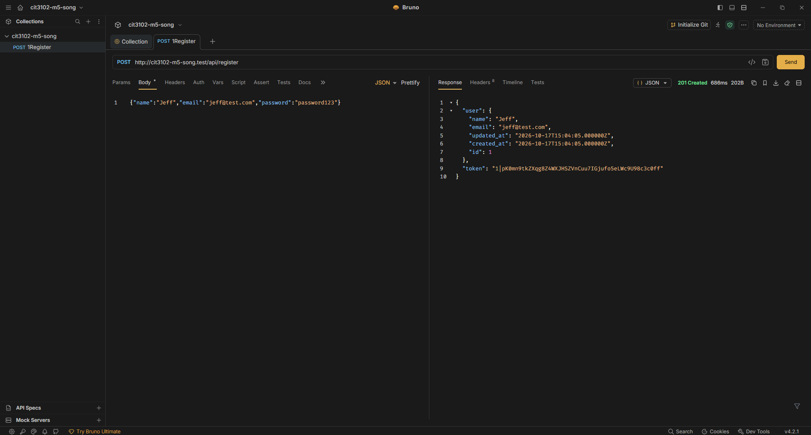
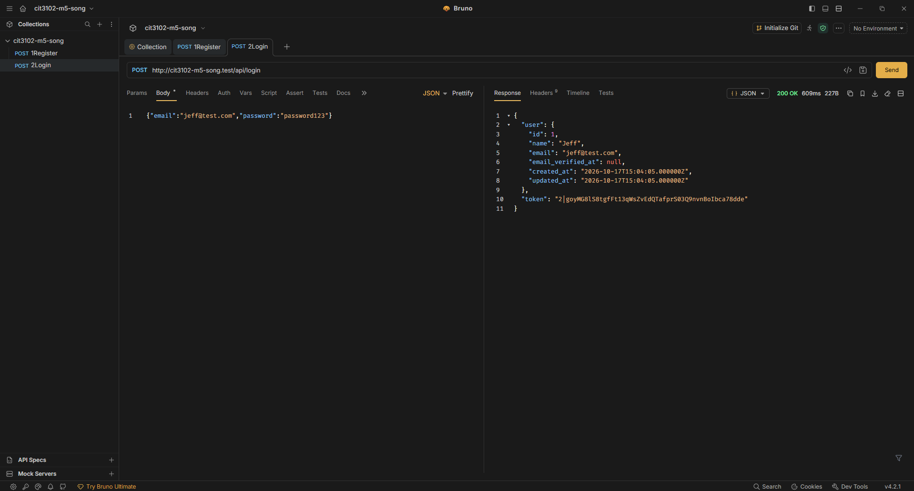
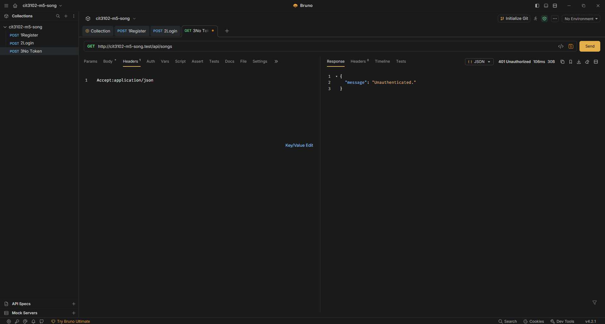
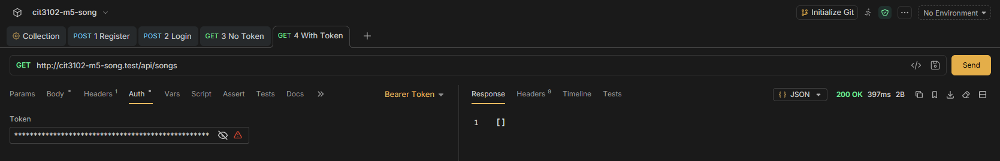
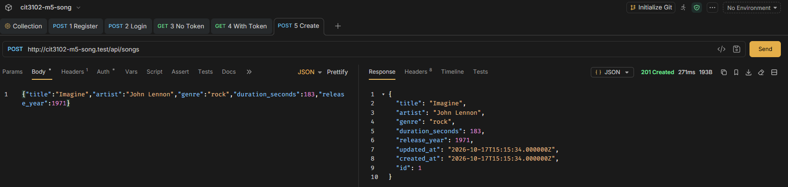
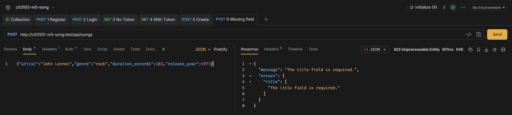
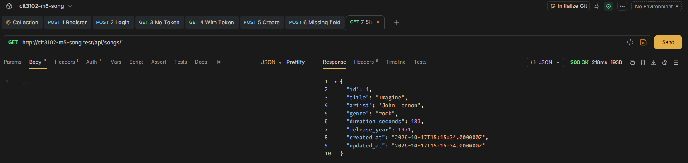
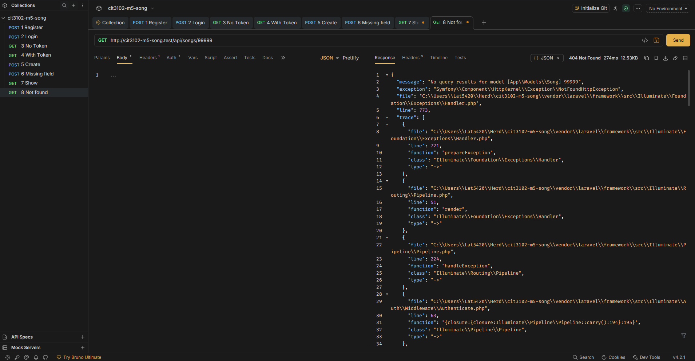
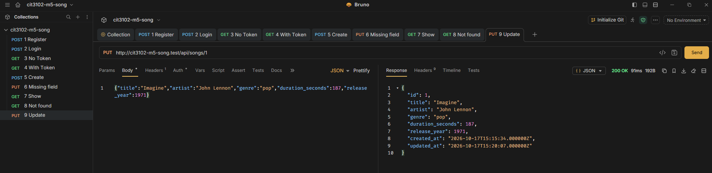
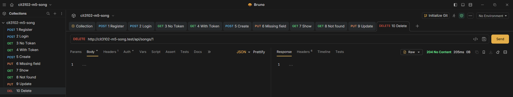

# Song API

**Partners:** Padiernos, Jefferson, Sepnio, Marc Iris
**Section:** IT2E
**Resource:** Song (title, artist, genre, duration_seconds, release_year)

## Setup

```
git clone <repo-url>
cd cit3102-m5-song
composer install
cp .env.example .env
php artisan key:generate
```

Create an empty file named `database/database.sqlite`, then run:

```
php artisan migrate
```

Put the folder in your Herd directory and open `http://cit3102-m5-song.test`, or run `php artisan serve`.

## Routes

| Verb | Path | What it does | Token needed |
|---|---|---|---|
| POST | /api/register | Creates a user and returns a token | No |
| POST | /api/login | Logs in and returns a token | No |
| POST | /api/logout | Deletes the current token | Yes |
| GET | /api/me | Shows the logged-in user | Yes |
| GET | /api/songs | Lists songs (filter by genre, artist, release_year) | Yes |
| POST | /api/songs | Creates a song | Yes |
| GET | /api/songs/{song} | Shows one song | Yes |
| PUT | /api/songs/{song} | Updates a song | Yes |
| DELETE | /api/songs/{song} | Deletes a song | Yes |

## Screenshots

1. POST /api/register (201)



2. POST /api/login (200)



3. GET /api/songs with no token (401)



4. GET /api/songs with token (200)



5. POST /api/songs with valid data (201)



6. POST /api/songs with a required field missing (422)



7. GET /api/songs/1 (200)



8. GET /api/songs/99999 (404)



9. PUT /api/songs/1 (200)



10. DELETE /api/songs/1 (204)



## Why does DELETE return 204 and not 200?

If the request is successful and no content is returned, DELETE returns 204. The body of the response is typically returned along with 200 OK, such as the resource that was retrieved or modified. When a DELETE is done, the record is no longer available and there is no resource to return. If the deletion is successful, 204 No Content is returned to the client and the body is empty. This API calls SongController::destroy(), which will delete the song and return response()->noContent(), which will return the 204.